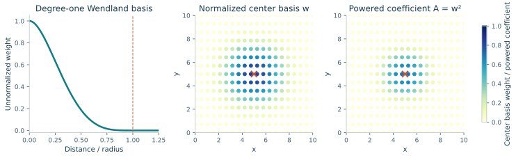
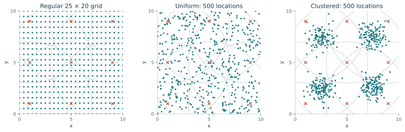
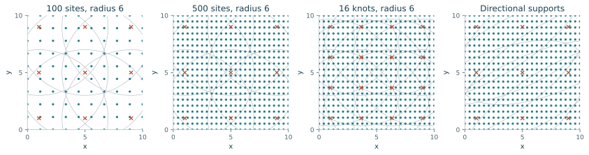
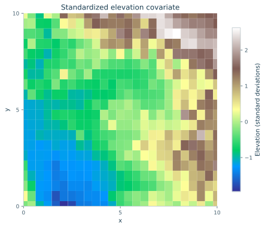
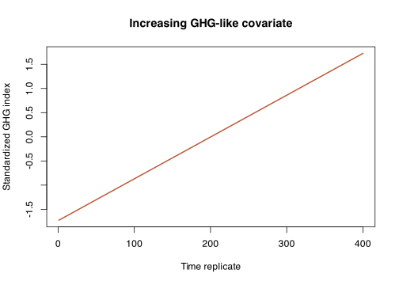
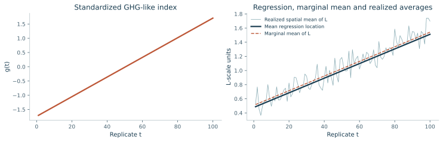
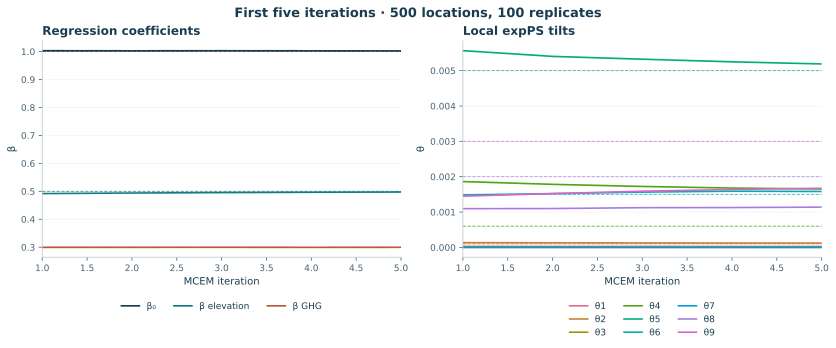
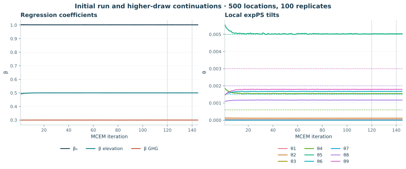

```{r setup, include=FALSE}
knitr::opts_chunk$set(echo=TRUE, warning=FALSE, message=FALSE)
source("maxid_regression_mcem.R")
source("maxid_regression_fast_fit.R")
source("maxid_tutorial_examples.R")
```

This tutorial develops the model used by `simulate_model()` and `fit_mcem_fast()`, explains what each parameter controls, and shows how to change the spatial design. The dependence construction uses an expPS spatial field and independent log-Laplace noise on the *log scale*. The regression is an addition made for this simulation study; this revision does not subtract the population mean of log B. 


```{r load-code, eval=FALSE}
source("maxid_regression_mcem.R")
source("maxid_regression_fast_fit.R")
source("maxid_tutorial_examples.R")
```


## 1. The model definition

Let $s_i\in\mathbb R^2$ denote location $i$, $t=1,\ldots,T$ index independent spatial replicates, and $k=1,\ldots,K$ index the basis functions. The low-dimensional representation is constructed by

$$
A_{ik}=w_{ik}^{1/\alpha},\qquad
B_{it}=\sum_{k=1}^{K}A_{ik}Z_{kt},\qquad
S_{it}=B_{it},\qquad
Z_{kt}\overset{\mathrm{ind}}{\sim}\operatorname{expPS}(\alpha,\theta_k).
$$

\color{red}{For now, $\alpha$ is fixed at 1/2 and $\alpha_0$ is fixed at 0.1}. The observation noise and positive process are

$$
E_{it}\overset{\mathrm{iid}}{\sim}\operatorname{Laplace}(0,\alpha_0),
\qquad \epsilon_{it}=\exp(E_{it}),\qquad R_{it}=\epsilon_{it}S_{it}.
$$

We use the max-id process on the log scale without mean-centering. We also add a regression term as the first-order effect 

$$
\begin{aligned}
\textcolor{red}{\mu_{it}}&=\textcolor{red}{\beta_0+\beta_{\mathrm{elev}}e_i+\beta_{\mathrm{ghg}}g_t},\\
m_{S,i}(\boldsymbol\theta)&=E_{\boldsymbol\theta}[\log S_{it}]
                         =E_{\boldsymbol\theta}[\log B_{it}],\\
L_{it}&=\mu_{it}+c\log S_{it}+cE_{it}.
\end{aligned}
$$

Both the random spatial term and E have finite means on this logarithmic scale. Consequently,

$$
E[L_{it}\mid e_i,g_t]=\mu_{it}+c\,m_{S,i}(\boldsymbol\theta).
$$

Thus mu is the regression location term, rather than the marginal mean of L. The latter also depends on the tilts and spatial weights. The conditional median given Z is mu+c log S. Removing centering retains this parameter-dependent spatial level, but beta0 can still absorb a common level shift.

### 1.1 Parameters and scale balance

| Symbol | Interpretation | Default |
|---|---|---|
| $n,T$ | Locations and independent temporal replicates | 500, 400 |
| $K$ | Latent basis coefficients per replicate | 9 |
| $\alpha$ | Positive-stable index; also controls the weight power | Fixed at 1/2 |
| $\theta_k$ | Local exponential tilt | Estimated; simulation includes zeros |
| $\alpha_0$ | Separate Laplace scale of E | Fixed at 0.1 |
| $c$ | Scale applied to the uncentered log process and noise | Fixed at 0.12 in this example; can also be estimated |
| $e_i$ | Standardized, time-constant elevation covariate | Varies across sites |
| $g_t$ | Standardized increasing GHG-like index | Varies across times |
| $\boldsymbol\beta$ | Intercept, elevation effect, GHG effect | Truth (1, 0.5, 0.3) |


A fixed elevation covariate is informative through its spatial variation. The GHG index is informative through its time variation. The index changes the regression location; the tilts are constant across time. The spatial fields are independent between replicates, so this deterministic trend does not create residual temporal dependence.


## 2. Constructing a spatial design

### 2.1 Wendland weights and compact support

For the two-dimensional degree-one Wendland basis used in the code,

$$
\phi(r)=(1-r)_+^4(1+4r),\qquad (a)_+=\max(a,0).
$$

Here "degree one" refers to the Wendland smoothness index. For a knot $\kappa_k$ and support radius $\rho_k$,

$$
\widetilde w_{ik}=\phi\!\left(\frac{\lVert s_i-\kappa_k\rVert}{\rho_k}\right),
\qquad
w_{ik}=\frac{\widetilde w_{ik}}{\sum_{\ell=1}^K\widetilde w_{i\ell}}.
$$

Support radii are fixed at 6 for every knot. Every location must have at least one strictly positive weight. The design helper also rejects knots that have no positive weight at any observation location, since their tilt parameters cannot be inferred from those observations.



Two locations with **disjoint sets of active basis functions** depend on disjoint latent coefficients. Their random responses are therefore independent within a replicate, conditional on the fixed covariates. Locations with shared basis coefficients can be dependent. The magnitude and shape of that dependence depend on their relative weights and on the latent distributions; overlap alone is not a numerical correlation coefficient. When some tilts are zero, raw-scale covariance can be undefined.

### 2.2 Regular, uniform, and clustered locations

The spatial helper allows several sampling configurations while retaining the same model family:

```{r spatial-designs}
grid <- make_spatial_design(nx=25, ny=20)
uniform <- make_spatial_design("uniform", n=500, seed=2026)
clustered <- make_spatial_design("clustered", n=500, seed=2026)
```

The clustered design uses four Gaussian clusters and rejects proposed coordinates outside the domain. It avoids accumulating artificial piles of points at the boundary by clipping coordinates.



Clustered configuration is not recommended: dense sampling in one part of the domain provides more information about the local latent field there. It does not automatically provide equally good information about all nine tilt parameters. This matters when a basis has only a few locations that distinguish it from adjacent bases.

### 2.3 Changing radii, knot density, and directional dependence

```{r support-configurations}
sparse_grid <- make_spatial_design(nx=10, ny=10, radii=6)
dense_grid <- make_spatial_design(nx=25, ny=20, radii=6)

# Sixteen basis functions instead of nine.
dense_knots <- make_spatial_design(knot_nx=4, knot_ny=4, radii=6)

# Longer support in one direction, rotated by 30 degrees.
M <- anisotropic_metric(angle=30, axis_scales=c(1.8, 0.8))
anisotropic <- make_spatial_design(metric=M, radii=6)
```

For anisotropic weights, the distance becomes $\lVert M(s_i-\kappa_k)\rVert$. With the metric above, each support is an ellipse with semi-axis lengths $6\times1.8$ and $6\times0.8$, rotated by 30 degrees. The ellipse is determined by the support radius in transformed coordinates.



Each knot uses the fixed radius:

```{r local-radii}
local_radii <- make_spatial_design(
  radii=rep(6, 9)
)
range(rowSums(local_radii$W > 0))  # number of active bases at a location
```

To use supplied coordinates, pass an n by 2 matrix of locations and a K by 2 matrix of knots:

```{r supplied-coordinates, eval=FALSE}
custom <- make_spatial_design(
  locations=location_matrix,
  knots=knot_matrix,
  radii=6,
  xlim=c(0,10), ylim=c(0,10),
  elevation=elevation_vector,
  nt=100
)
```

Distances and radii must use the same units. For geographic applications, use an appropriate projected coordinate system or explicitly implement an appropriate distance metric. The helper's Euclidean matrix transformation is intended for planar coordinates.

If locations fall outside all fixed-radius supports, some locations can have S identically zero and a logarithm is undefined. The helper catches that situation:

```{r uncovered-design}
bad <- try(make_spatial_design(locations=matrix(c(20,20,21,21), ncol=2)), silent=TRUE)
inherits(bad, "try-error")        # TRUE for this design
```

Add or reposition knots to obtain valid coverage. Adding a small constant to S to bypass this error would specify a different observation model.


## 3. Simulating the field and regression

### 3.1 Define the two covariates

The *elevation surface* is obtained from AWS Terrain Tiles at the coordinates (x/2-115, y/2+30), using `get_elev_point(..., prj=4326, src="aws", z=6)`, and standardized across the sampled locations. No additional smoothing is applied to the retrieved elevations. It remains fixed at every time. The *GHG-like index* is a standardized linear sequence from 0 to 1 over T times. The zoom level determines the DEM resolution; unsmoothed here means no extra smoothing in the code, rather than native-resolution terrain data. The default lookup now covers longitude -115 to -110 and latitude 30 to 35. This coordinate mapping changes the elevation lookup; the Wendland design still uses the planar domain [0,10]^2 and radii 6.

```{r covariates, fig.show="hide"}
d <- make_spatial_design(nx=25,ny=20,nt=400,            # 25 by 20 regular grid/Lattice, 400 times
                         knot_nx=3,knot_ny=3,radii=6) # 9 knots for Wendland basis functions with a radius of 6
# To reproduce the supplied figures without another terrain download, pass
# elevation=read.csv("elevation_grid.csv")$elevation_m in the call above.
e <- d$elev              # length n = nx times ny
g <- d$ghg               # length T =400
range(e)
range(g)

# Elevation surface: one covariate value per location, fixed over time.
x_grid <- sort(unique(d$xy[, 1]))
y_grid <- sort(unique(d$xy[, 2]))
e_surface <- matrix(NA_real_, length(x_grid), length(y_grid))
e_surface[cbind(match(d$xy[, 1], x_grid),
                match(d$xy[, 2], y_grid))] <- e
image(x_grid, y_grid, e_surface, col=hcl.colors(64, "Terrain"),
      xlab="x", ylab="y", main="Standardized elevation", asp=1)

# GHG index: one covariate value per time, shared across all locations.
plot(seq_along(g), g, type="l", lwd=2, col="#bd5737",
     xlab="Time replicate", ylab="Standardized GHG index",
     main="Increasing GHG-like covariate")
```





Since each covariate has sample standard deviation one, beta_elev and beta_ghg represent the change in the regression location for a one-standard-deviation covariate increase, holding the spatial weights and tilts fixed. A change in elevation across actual sites may also change the spatial contribution to the marginal mean. 

### 3.2 Choose the latent tilts

For nine bases the pattern used in this example is

```{r true-parameters}
theta <- c(0, 0.0001, 0, 0.0006, 0.005, 0.0015, 0, 0.002, 0.003)
beta <- c(intercept=1, elevation=0.5, GHG=0.3)
cbind(d$knots, theta=theta)
```


### 3.3 Draw 400 independent spatial replicates

```{r simulate-grid}
sim <- simulate_spatial(d, theta=theta, beta=beta,
                        cscale=0.12, alpha0=0.1, seed=43) # cscale is the multiplicative coef on the max-id model
```


### 3.4 Inspect the scale balance

With S=B and the smaller noise scale, the spatial component remains visible while the white noise is negligible relative to both the spatial field and the regression location. In the example with seed 43, c=0.12, and alpha0=0.1, the standard deviations across all sites and times are approximately:

| Component of L | Empirical standard deviation |
|---|---:|
| Regression location $\mu$ | 0.5825 |
| Uncentered spatial term $c\log S$ | 0.2155 |
| White noise $cE$ | 0.0170 |

Removing population centering changes the spatial level and gives a spatial standard deviation of 0.2155 for these draws. For S=B with the same latent draws, reducing alpha0 from 1 to 0.1 changes the white-noise standard deviation proportionally while preserving the spatial standard deviation 0.2155. The white-noise variance is now about 0.6% of the spatial variance.

These are properties of this realization, not guarantees for every seed. Rare large positive-stable draws remain possible. Inspect the data rather than forcing every simulated replicate to have a fixed empirical variance.

```{r scales}
sapply(sim[c("mu","spatial","noise")], function(x) sd(as.vector(x)))
```




Reduce c at a fixed alpha0 to reduce both random components. With S=B, alpha0 controls only the white noise. Reducing alpha0 from 1 to 0.1 reduces its standard deviation tenfold while preserving the same spatial field for the same latent draws. In this realization the white-noise standard deviation is about 7.1% of the spatial standard deviation. Change beta to adjust the deterministic effects. Do not rescale each realized field after simulating it; that would change the joint model.

### 3.5 Estimate the parameters using Monte Carlo EM (MCEM) algorithm

The details for MCEM algorithm are given in Sections 6--8. To fit the model on the simulated data, we run the checked initial budget below. Section 9.3 continues this fit with a larger Monte Carlo budget and checks the final posterior:

```{r fit-model, eval=params$run_fit}
fit <- fit_mcem_fast(
  sim,
  iterations=120,
  draws_start=100,
  draws_end=500,
  burn_first=800,
  burn=150,
  m_cycles = 2,
  seed=91,
  estimate_c=FALSE,c_fixed=0.12,
  location_augmentation=TRUE,
  uncertainty="louis"   # adds approximate iteration-level SE/CI bands; Section 9.5
)

fit$beta             # Estimated regression location coefficients
fit$theta            # Estimated local expPS tilts: raw EM fixed-point value
fit$theta_jackknife  # Bias-corrected tilts (Section 8.4); the recommended estimate
fit$cscale           # Fixed at 0.12 here; alpha0 remains fixed at sim$alpha0
subset(fit$uncertainty, iteration==nrow(fit$history))[,c("parameter","estimate","se","lower","upper")]
```

### 3.6 Visualize the parameter estimates

`plot_mcem_traces()` draws the same beta and theta traces as a hand-written `matplot()` would, but also shades the Louis-information bands from `uncertainty="louis"` and marks the jackknife-corrected final tilts (Section 8.4):

```{r param-visual, eval=params$run_fit}
plot_mcem_traces(fit, sim$beta, sim$theta, bands="statistical",
                 main="MCEM parameter traces with Louis uncertainty bands")
```


## 4. The expPS and log-Laplace distributions

### 4.1 Exponential tilting of a positive-stable variable

The unit-scale positive-stable distribution used here has Laplace transform

$$
E[\exp(-uZ)]=\exp(-u^{\alpha}),\qquad u\geq0.
$$

Its exponentially tilted density is

$$
h(z;\alpha,\theta)=f_{\alpha}(z)\exp(-\theta z+\theta^{\alpha}),\qquad z>0.
$$

The factor $\exp(\theta^{\alpha})$ normalizes the density. It depends on the parameter, so it must remain in the likelihood when estimating theta. Its Laplace transform is

$$
E_{\theta}[\exp(-uZ)]
=\exp\{\theta^{\alpha}-(\theta+u)^{\alpha}\}.
$$

Larger tilts downweight large latent coefficients. At a positive tilt,

$$
E_{\theta}[Z]=\alpha\theta^{\alpha-1},\qquad
\operatorname{Var}_{\theta}(Z)=\alpha(1-\alpha)\theta^{\alpha-2}.
$$

At zero tilt and $\alpha<1$, Z has infinite mean. Hence B has infinite mean at a location influenced by a zero-tilt basis. With S=B, E[S] is also infinite at such a site. The separate scale alpha0=0.1 gives exp(E) a finite mean, but it does not remove the infinite mean of S. Subtracting E[R] is therefore not a valid centering operation here. The expectation of log S is finite and determines the additional marginal mean contribution c E(log S); it is not subtracted in this model.

The implemented fitter fixes $\alpha=1/2$. At this value,

$$
f_{1/2}(z)=\frac{1}{2\sqrt\pi}\,z^{-3/2}\exp\{-1/(4z)\},
\qquad Z=\frac{1}{2G^2},\quad G\sim N(0,1).
$$

This identity gives an exact positive-stable sampler. Exponential tilting is implemented by rejection: generate a positive-stable proposal z and accept it with probability $\exp(-\theta z)$. The acceptance probability averaged over proposals is $\exp(-\sqrt\theta)$. For $\theta\leq0.005$, it is at least about 0.932. The simulator is exact for these draws; it does not truncate large latent values.

```{r tilted-draws}
# Functions defined in the original simulation script.
set.seed(47)
z0 <- rexpPS_half(1000, theta=0)
z1 <- rexpPS_half(1000, theta=0.01)
quantile(z0, c(.5, .9, .99))
quantile(z1, c(.5, .9, .99))
```

When theta is zero, a sample average of Z is unstable and is not an estimator of a finite population mean. Quantiles and summaries on the log scale are more useful for exploratory plots.

### 4.2 Log-Laplace white noise

Under the revised scale convention,

$$
f_E(e)=\frac{1}{2\alpha_0}\exp(-|e|/\alpha_0),\qquad
\operatorname{SD}(E)=\sqrt2\alpha_0.
$$

The code draws E with `rlaplace(n, b=alpha0)`. The density of $\epsilon=\exp(E)$ is

$$
f_\epsilon(x)=\frac{1}{2\alpha_0x}
 \exp\{-|\log x|/\alpha_0\},\qquad x>0.
$$

E has mean zero, and epsilon has median one. Its moments satisfy

$$
E[\epsilon^p]=\frac{1}{1-p^2\alpha_0^2}
\quad\text{when }|p|\alpha_0<1.
$$

For positive p outside that range the moment is infinite. In particular, E[epsilon] is finite only for alpha0<1; it is finite at the default alpha0=0.1. This does not prevent fitting a finite mean for L.

The noise term cE in L has scale d=c*alpha0 and standard deviation $\sqrt2d$. At d=0.012, its population standard deviation is approximately 0.01697. Increasing alpha0 at a fixed c increases only the white noise in L; the spatial field does not change.


## 5. Computing the model-implied marginal mean

This calculation is optional: the simulator and fitter do not evaluate or subtract m_B. It can be used to compute the marginal mean mu+c m_B. For alpha=1/2, the unpowered sum B has Laplace transform

$$
L_{B,i}(u)=E[\exp(-uB_i)]
=\exp\left[\sum_{k=1}^K\left\{
\sqrt{\theta_k}-\sqrt{\theta_k+uA_{ik}}\right\}\right],\qquad A_{ik}=w_{ik}^2.
$$

The field S=B has this same Laplace transform. Its log mean is:

$$
\begin{aligned}
m_{B,i}(\boldsymbol\theta)
 &=\int_0^\infty\frac{e^{-u}-L_{B,i}(u)}{u}\,du\\
 &=\int_{-\infty}^{\infty}\{e^{-e^v}-L_{B,i}(e^v)\}\,dv,\\
m_{S,i}(\boldsymbol\theta)&=m_{B,i}(\boldsymbol\theta).
\end{aligned}
$$

`mean_log_sum()` returns m_B. `mean_log_field()` returns m_S. Both use deterministic trapezoidal integration with 601 points between -36 and 30 on v=log u. `make_center_cache()` precomputes u*A, not u*W, and stores means and derivatives at exact matching tilt vectors.

```{r centering-check}
m601 <- mean_log_field(sim$W, sim$theta, ng=601, alpha0=sim$alpha0)
m1201 <- mean_log_field(sim$W, sim$theta, ng=1201, alpha0=sim$alpha0)
max(abs(m601-m1201))
```

The refinement difference for the default simulation is below 1e-9. Check the integration limits as well as the number of nodes for other weight scales or parameter ranges. Refining the nodes alone does not assess truncation error.

### 5.1 The all-zero-tilt check

If all theta values are zero, stable summation gives

$$
L_{B,i}(u)=\exp\{-\sqrt u\sum_k w_{ik}\},\qquad
m_{B,i}(\mathbf0)=2\log\Big(\sum_k w_{ik}\Big)+\gamma.
$$

Here gamma is Euler's constant. For row-normalized W, the row sum is one, so every site has the same marginal positive-stable distribution for B and

$$
m_{B,i}(\mathbf0)=\gamma,\qquad
m_{S,i}(\mathbf0)=\gamma.
$$

This is one reason for using w^(1/alpha) inside the sum. Equal marginals do not imply identical spatial dependence: overlap and relative weights still govern which latent coefficients are shared.

```{r zero-tilt-check}
gamma <- -digamma(1)
mzero <- mean_log_field(sim$W, rep(0,ncol(sim$W)), alpha0=sim$alpha0)
max(abs(mzero-gamma))
```

### 5.2 Optional derivatives of the marginal mean

The tilt is parameterized by $\eta_k=\sqrt{\theta_k}\geq0$. The optional mean cache can also return derivatives. For an active coefficient,

$$
\frac{\partial}{\partial\eta_k}
\{\eta_k-\sqrt{\eta_k^2+uA_{ik}}\}
=1-\frac{\eta_k}{\sqrt{\eta_k^2+uA_{ik}}}.
$$

Differentiating the same quadrature gives

$$
\frac{\partial m_{B,i}}{\partial\eta_k}
=-\int_0^\infty\frac{L_{B,i}(u)}u
 \left(1-\frac{\eta_k}{\sqrt{\eta_k^2+uA_{ik}}}\right)du,
\qquad
\frac{\partial m_{S,i}}{\partial\eta_k}
=\frac{\partial m_{B,i}}{\partial\eta_k}.
$$

A zero weight contributes exactly zero, including at eta=0. The implementation handles these rows explicitly. At exact zero tilt, derivatives of the limiting expectation can be singular; finite-range quadrature derivatives do not establish smooth boundary behavior.

The cache returns `mean` and `gradient` for log S, and `base_mean` and `base_gradient` for log B. With S=B these pairs coincide. Neither these means nor their gradients enter the uncentered fitting objective. W, alpha, alpha0, and the quadrature controls are fixed when each cache is built.

## 6. From the model to the likelihood

### 6.1 Conditional likelihood given the latent field

Given Z_t, each L observation has a Laplace distribution with location $\mu_{it}+c\log S_{it}$ and scale $d=c\alpha_0$:

$$
f(L_{it}\mid Z_t,\boldsymbol\beta,\boldsymbol\theta,c)
=\frac1{2c\alpha_0}
\exp\left[-\frac{|L_{it}-\mu_{it}-c\log S_{it}|}{c\alpha_0}\right].
$$

Equivalently,

$$
f(L_{it}\mid Z_t)=\frac1{2d}
\exp\left[-\left|\frac{L_{it}-\mu_{it}}d-\frac{\log B_{it}}{\alpha_0}\right|\right].
$$

The absolute-deviation term has coefficient one after standardizing both the response residual and spatial offsets. The latter are divided by alpha0 because S=B is no longer raised to the noise-scale power. The conditional density factors over sites, but the marginal density does not because sites share Z_t.

### 6.2 Observed marginal likelihood

For one independent replicate,

$$
p(L_t\mid\boldsymbol\beta,\boldsymbol\theta,c)
=\int_{(0,\infty)^K}p(L_t\mid z_t,\boldsymbol\beta,\boldsymbol\theta,c)
 \prod_{k=1}^K h(z_{kt};1/2,\theta_k)\,dz_t.
$$

The MLE maximizes

$$
\ell(\boldsymbol\beta,\boldsymbol\theta,c)
=\sum_{t=1}^T\log p(L_t\mid\boldsymbol\beta,\boldsymbol\theta,c).
$$

At K=9 and T=400, this involves 400 nine-dimensional integrals. The 3600 latent coefficients do not require one coupled 3600-dimensional integral. MCEM optimizes this marginal likelihood indirectly through posterior expectations.

If the observation is X=exp(L), its density includes the Jacobian product of 1/X_it. That factor is fixed with respect to beta, theta, and c, so it does not change their maximizers. Beta describes the regression location of log X; its marginal mean also includes c m_B.

### 6.3 Complete-data likelihood

Write theta_k=eta_k². The candidate-dependent complete-data log likelihood is

$$
\begin{aligned}
\ell_c(\boldsymbol\beta,\boldsymbol\eta,c;L,Z)
={}&-nT\log d-\sum_{i,t}\left|\frac{L_{it}-\mu_{it}}d
                  -\frac{\log B_{it}}{\alpha_0}\right|\\
&+\sum_{k,t}\{-\eta_k^2 Z_{kt}+\eta_k\}
+\text{terms independent of }\boldsymbol\beta,\boldsymbol\eta,c.
\end{aligned}
$$

The expPS normalizer exp(eta_k) is essential to parameter estimation. For this classical Z augmentation, the positive-stable density depends on Z but not on beta, eta, or c, so it can be omitted from the M-step objective; it must remain in the latent posterior. The equivalent r augmentation in Section 8.4 makes that density parameter-dependent and retains its full terms. The Laplace factor 1/(2d) depends on c and must remain in the M-step objective; alpha0 is fixed.

## 7. The Monte Carlo E-step

At iteration j, EM forms

$$
Q(\psi\mid\psi^{(j)})
=E_{Z\mid L,\psi^{(j)}}[\ell_c(\psi;L,Z)],\qquad
\psi=(\boldsymbol\beta,\boldsymbol\eta,c).
$$

The E-step samples Z from the posterior conditional on L and the current parameters, not from its unconditional expPS prior. Each time replicate has its own latent posterior.

### 7.1 Sample on the log-latent scale

Let q_kt=log Z_kt and define

$$
a_{it}=\frac{L_{it}-\mu_{it}}c.
$$

Apart from constants independent of q_t,

$$
\begin{aligned}
\log\pi(q_t\mid L_t)
={}&-\frac1{\alpha_0}\sum_i\left|a_{it}-\log\Big(\sum_k A_{ik}e^{q_{kt}}\Big)\right|\\
&-\frac12\sum_kq_{kt}-\frac14\sum_ke^{-q_{kt}}
-\sum_k\theta_ke^{q_{kt}}+\text{constant}.
\end{aligned}
$$

The coefficient -1/2 in front of q includes the Jacobian dz=exp(q)dq. Omitting it would sample the wrong posterior. ExpPS normalizing constants cancel in Metropolis ratios with theta held fixed, but not in the M-step. Here a is on the log-B scale, so the absolute-deviation loss has coefficient 1/alpha0.

### 7.2 Joint proposals for overlapping bases

For each time replicate, propose

$$
q_t^*=q_t+s_t C_t^{1/2}\xi_t,\qquad \xi_t\sim N(0,I_K).
$$

Each replicate has its own covariance C_t and proposal scale s_t. With covariance and scale held fixed for the move, this proposal is symmetric. Accept it with probability min(1, exp(log pi(q*) - log pi(q))). The code handles independent replicates in one routine; it does not use multiple CPU processes.

Define the local log-sum derivatives

$$
D_{ik,t}=\frac{A_{ik}e^{q_{kt}}}{B_{it}}.
$$

The reference proposal information is

$$
H_t=\frac1{\alpha_0^2}D_t^{\mathsf T}D_t
+\operatorname{diag}\{\tfrac14e^{-q_{kt}}+\theta_ke^{q_{kt}}\},
\qquad C_t\approx H_t^{-1}.
$$

On the log-B scale the conditional Laplace location information is 1/alpha0², so its contribution is D'D/alpha0². The diagonal term comes from prior curvature on q. A small ridge stabilizes inversion. This matrix constructs proposals; it is not observed-data information for beta, theta, and c.

During warm-up, empirical covariance is blended with this reference, and proposal scales are tuned toward joint acceptance around 0.234. Every fifth sweep also includes coordinate moves. Adaptation stops before retained draws. The latent and proposal states are carried between EM iterations.

Posterior-mode searches supply initial q values. They are starting points only; the E-step continues to sample and integrate over the latent posterior.

### 7.3 What is retained

For M retained draws, the E-step supplies

$$
\overline Z_k=\frac1{TM}\sum_{t=1}^T\sum_{r=1}^MZ_{kt}^{(r)},
\qquad \log B_{it}^{(r)}.
$$

The expected Z values determine the expPS part of the M-step. The sampled log B fields determine the expected absolute-deviation loss. The internal `logs` array stores log B=log S. The M-step offset cache divides these draws by alpha0. Replacing it with a mean field is incorrect because

$$
E[|L-\mu-c\log B|]
\ne |L-\mu-cE[\log B]|
$$

in general. The absolute value must be averaged over the retained fields.

## 8. Separate conditional M-steps

The faster fitter implements Monte Carlo generalized ECM on the same posterior draws. The classical Z augmentation has separate LAD, closed-form tilt, and optional c updates. For fixed c, the default equivalent location augmentation jointly updates the intercept, GHG coefficient and tilts, with a separate elevation LAD update. Both require improvement of sampled Q rather than an exact posterior expectation.

The negative sampled Q, up to constants, is

$$
\begin{aligned}
J(\boldsymbol\beta,\boldsymbol\eta,c)
={}&nT\log d+\frac1M\sum_{r,i,t}\left|
\frac{L_{it}-\mu_{it}}d-\frac{\log B_{it}^{(r)}}{\alpha_0}\right|\\
&+T\sum_k\{\eta_k^2\overline Z_k-\eta_k\}.
\end{aligned}
$$

The code divides J by nT for numerical scaling without changing its minimizer. In the original coordinate-sampler fitter, beta, eta, and c are optimized jointly. The faster fitter uses the following separate updates, sorted sampled offsets, and joint latent proposals; no centering cache is evaluated during fitting.

### 8.1 The beta update is LAD regression

For fixed eta and c, define

$$
Y_{it}^{(r)}=L_{it}-c\log B_{it}^{(r)}
           =L_{it}-c\log S_{it}^{(r)}.
$$

Then minimize

$$
\frac1M\sum_{r,i,t}|Y_{it}^{(r)}-x_{it}^{\mathsf T}\boldsymbol\beta|,
\qquad x_{it}=(1,e_i,g_t)^{\mathsf T}.
$$

This is least-absolute-deviations regression because the conditional noise is Laplace. The omitted factor 1/d is constant during this beta update. Ordinary least squares initializes beta but does not replace LAD.

In the classical Z augmentation there are nT design rows and three columns; the fixed-c location augmentation uses the single elevation column for LAD. The code avoids expanding this design to nTM rows even though there are M sampled pseudo-responses for each observation. At 2000 retained draws that avoids 100 million repeated design rows.

### 8.2 The grouped LAD solver

ADMM separates projection onto the regression design from the absolute-deviation loss. With fitted values h and scaled dual vector u, the projection update is

$$
\boldsymbol\beta\leftarrow(X^{\mathsf T}X)^{-1}X^{\mathsf T}(h-u).
$$

The code uses a cached Cholesky factor for this three by three system, or the scalar system in the fixed-c location augmentation. Each observation row then solves

$$
h_j\leftarrow\arg\min_z\left\{
\frac1M\sum_r|z-Y_j^{(r)}|+\frac\rho2(z-b_j)^2\right\}.
$$

Here b_j is the relaxed projected value plus the dual value. Sorted sampled offsets make the one-dimensional proximal map solvable by binary search over its piecewise-linear derivative. The implementation multiplies the standardized offsets log B/alpha0 by d=c*alpha0, giving c*log B in the pseudo-responses.

The code uses relaxation 1.6, balances the ADMM penalty, retains improving beta values, and carries the ADMM state forward. `lad_converged` reports whether primal and dual tolerances were met. A finite cap can stop an improving update before those tolerances are satisfied.

### 8.3 Sorting sampled offsets accelerates the likelihood

At each site/time, sort the M log B/alpha0 draws (or log(sum A V)/alpha0 under the equivalent fixed-c augmentation) as $b_{(1)}\leq\cdots\leq b_{(M)}$. Let r0 be the number at or below a target a. Then

$$
\frac1M\sum_r|a-b_{(r)}|
=\frac{a(2r_0-M)+\sum_rb_{(r)}-2\sum_{r\leq r_0}b_{(r)}}M.
$$

The corresponding subgradient is 2r0/M-1. Sorting and prefix sums are computed once per E-step. Row shifts, scaling and sorting are processed in blocks of 512 observation rows, avoiding the large intermediate arrays from sorting all rows at once. The cache still stores sorted draws and prefix sums, so its final memory use grows with nTM. Subsequent loss evaluations use binary searches, and no centering calculations are required.

### 8.4 The eta update and the fixed-c location augmentation

For the classical Z augmentation, the observation likelihood no longer depends on theta once Z is held fixed. Differentiating the expPS contribution gives

$$
\frac{\partial J}{\partial\eta_k}=T(2\eta_k\overline Z_k-1),\qquad
\eta_k^{\mathrm{new}}=\frac1{2\overline Z_k},\qquad
\theta_k^{\mathrm{new}}=\frac1{4\overline Z_k^2}.
$$

This is now the actual classical M-step update. It includes the expPS normalizer and requires no centering or quadrature derivatives. A finite posterior sample mean gives a strictly positive update, including when the simulation truth is zero. Small positive estimates at those bases are therefore expected; they are not evidence that the code excluded zero-tilt data. A zero-tilt population has infinite E(Z), and boundary inference is nonregular.

With a small white-noise scale, classical EM can still move slowly: changing the intercept while holding the same Z draws fixed incurs a strong conditional observation penalty. For fixed c, `location_augmentation=TRUE` instead uses the equivalent latent variables

$$
h_t=\frac{\beta_0+\beta_{\mathrm{ghg}}g_t}{c},\qquad
V_{kt}=e^{h_t}Z_{kt},\qquad r_{kt}=\log V_{kt}.
$$

The observation model becomes

$$
L_{it}=\beta_{\mathrm{elev}}e_i+
 c\log\left(\sum_k A_{ik}e^{r_{kt}}\right)+cE_{it}.
$$

The intercept and GHG coefficient now enter the transformed latent prior, rather than the conditional observation location. Its log density, including the transformation Jacobian, is

$$
\log p(r_{kt};h_t,\eta_k)
=-\tfrac12(r_{kt}-h_t)-\tfrac14e^{h_t-r_{kt}}
 -\eta_k^2e^{r_{kt}-h_t}+\eta_k+\text{constant}.
$$

This is a change of EM augmentation, not a change to the marginal observation model. The E-step still samples q=log Z at the old parameters and then translates draws to r=q+h_old. The elevation coefficient uses the separate LAD update with one design column and sampled offsets log(sum A V). The intercept, GHG coefficient and tilts use the transformed prior together.

Let M_kt and U_kt be the retained posterior averages of Z_kt and 1/Z_kt at the old parameters. For the candidate shift delta_t=h_t-h_old,t, the negative expected prior log density, up to constants, is

$$
J_{\mathrm{prior}}(\delta,\boldsymbol\eta)
=\tfrac14\sum_{k,t}U_{kt}e^{\delta_t}
 +\sum_{k,t}\eta_k^2M_{kt}e^{-\delta_t}
 -\tfrac K2\sum_t\delta_t-T\sum_k\eta_k.
$$

For delta_t=a+gamma*g_t, define

$$
H_k(\gamma)=\sum_tM_{kt}e^{-\gamma g_t},\qquad
I(\gamma)=\sum_t\left(\sum_k U_{kt}\right)e^{\gamma g_t},\qquad
C(\gamma)=\tfrac14\left\{I(\gamma)-\sum_k\frac{T^2}{H_k(\gamma)}\right\}.
$$

Profiling the tilts gives eta_k=exp(a)*T/(2H_k). Profiling a then gives

$$
e^a=\frac{KT}{2C(\gamma)},\qquad
\gamma^{\mathrm{new}}=\arg\min_\gamma\left\{
\frac{KT}{2}\log C(\gamma)-\frac K2\gamma\sum_tg_t\right\}.
$$

C is positive for nondegenerate posterior moments by Cauchy--Schwarz. The implementation checks positivity and evaluates its logarithm with stable log-sum-exp calculations. It optimizes this one-dimensional profile with an analytic derivative, sets beta0_new=beta0_old+c*a and beta_ghg_new=beta_ghg_old+c*gamma, and uses the corresponding analytic eta values. At the next E-step it warm-starts q_new=q_old-delta, preserving the retained V scale. Sampled-Q checks cover both the observation and transformed prior terms.

The fixed-c example uses this augmentation by default; `location_augmentation=FALSE` selects the classical Z augmentation for comparison. This reduces the intercept/trend coupling, but does not eliminate overlap between basis functions or finite-T uncertainty. The location augmentation requires fixed c. With `estimate_c=TRUE`, the default is the classical Z augmentation; when switching a resumed fixed-c fit to estimated c, also pass `location_augmentation=FALSE`.

For classical fits with beta and theta fixed, c is updated through the positive reciprocal scale lambda=1/(c*alpha0). Writing r_it=L_it-mu_it, minimize the convex function

$$
F(\lambda)=-\log\lambda+
\frac1{nTM}\sum_{r,i,t}\left|
\lambda r_{it}-\frac{\log B_{it}^{(r)}}{\alpha_0}\right|,
\qquad \lambda>0,\qquad c^{\mathrm{new}}=\frac1{\alpha_0\lambda^{\mathrm{new}}}.
$$

The code brackets the monotone subgradient and bisects, reusing the sorted offsets. The normalizing term -log(lambda) is essential; alpha0 stays fixed. With `estimate_c=FALSE`, every c update is skipped. The fitter performs m_cycles+1 LAD updates on the same draws, with c updates only in estimated mode; the tilt or profiled location update is computed once per E-step.

Both eta updates above are convex, reciprocal-type transforms of a time-averaged posterior Z moment, which gives their theta output a systematic finite-T upward bias (Section 9.3 derives why and quantifies it). By default, after the last iteration, `fit_mcem_fast` also applies an exact leave-one-replicate-out jackknife correction to theta and returns it as `fit$theta_jackknife`, reusing the last E-step's own posterior moments so it costs no extra MCMC draws. This is the recommended point estimate to report; `fit$theta` remains the raw EM value used for resuming a fit and for the Louis bands. Set `theta_jackknife=FALSE` to skip it.

### 8.5 Safeguarding each update

A candidate is accepted only if it decreases the same sampled J. Qgain is the decrease in J/(nT) within one iteration. It is not an observed log-likelihood estimate.

Exact EM's ascent statement applies to the exact posterior expectation. A Monte Carlo Q improvement does not certify an observed-likelihood increase. Different iterations use different draws, so their objectives cannot be compared as one fixed likelihood surface. [Caffo, Jank, and Jones (2005)](https://doi.org/10.1111/j.1467-9868.2005.00499.x) develop probabilistic ascent checks that adapt the Monte Carlo effort. This implementation uses a geometric draw schedule and same-sample update safeguards, not their full adaptive procedure.

## 9. Running and checking the fit

### 9.1 Read the controls as sampling and optimization budgets

| Control | Default | Purpose |
|---|---:|---|
| iterations | 35 | Number of outer MCEM/ECM iterations |
| draws_start, draws_end | 80, 600 | Geometrically increasing retained draws per time |
| burn_first, burn | 800, 150 | Initial and subsequent posterior warm-up sweeps |
| thin | 1 | Retain every sweep by default |
| m_cycles | 1 | Conditional LAD/tilt/c alternations within an E-step |
| lad_maxit | 200 | Maximum ADMM iterations per LAD update |
| theta_maxit | 60 | Maximum iterations for the profiled GHG-shift optimization; classical tilt update is analytic |
| center_ng | 601 | Compatibility control; not used in uncentered fitting |
| c_init | NULL | Optional initial c when estimating c; otherwise initialized from regression residuals |
| estimate_c | TRUE | Estimate c; set FALSE to hold it fixed |
| c_fixed | NULL | Required positive fixed c when starting a fixed-c fit |
| start | NULL | Optional previous parameters and sampler/ADMM states |
| seed | 91 | Reproducible RNG initialization for the fit |
| theta_jackknife | TRUE | Add a leave-one-replicate-out bias-corrected `theta_jackknife` field (Section 8.4) at no extra MCMC cost |
| uncertainty | "none" | Set "louis" for approximate per-iteration SE/CI bands on beta and theta (Section 9.5) |
| uncertainty_level | 0.95 | Nominal coverage for the Louis-information interval, not a validated frequentist guarantee |
| uncertainty_bandwidth | 0.1 | Residual-density kernel bandwidth for the elevation Laplace curvature term |
| uncertainty_final | TRUE | Recompute the Louis table once more at the last iterate with that iterate's own draws |

The code does not automatically stop when a convergence criterion is satisfied. These settings define a run budget. Longer runs and more retained draws should be driven by traces and posterior Monte Carlo error.

### 9.2 Actual five-iteration execution check

This pilot check and its figure are retained from the T=100 revision of this tutorial and have not been rerun at T=400; the mechanics they illustrate (geometric draw schedule, LAD/profile safeguards) do not depend on T. Section 3.5--3.6 above show the current T=400 fit.

The illustration below shows the first five iterations of the fresh 120-iteration run on a 500-location, 100-replicate simulation, with uncentered S=B, alpha0=0.1 and c fixed at 0.12. The geometric schedule retained 100 to 106 draws per time over these first five iterations. The LAD flag was one in 0 of five iterations; the other iterations contained a capped LAD sub-update, followed by further ADMM updates. All location-profile optimizations reported successful termination, and all sampled Q gains were nonnegative. The E- and M-step work in these five iterations took approximately 53 seconds in this environment.



The fifth-iteration beta estimates were approximately (1.0024, 0.4974, 0.2996), compared with truths (1, 0.5, 0.3). The value of c remained exactly 0.12, with alpha0 fixed at 0.1. Median effective sample sizes of individual log-latent coordinates ranged from about 9.5 to 10.0, with a minimum near 2.8. These short runs illustrate execution and diagnostics; they do not establish tilt recovery or MCEM convergence.

### 9.3 Diagnostics and their interpretation

| Returned quantity | What it tells you | What it does not establish |
|---|---|---|
| Qgain | Same-sample complete-data objective improved | Observed likelihood ascent or global convergence |
| delta_beta, delta_eta, delta_c | Size of the latest parameter update | Whether sampling noise masks further movement |
| joint_acceptance | Acceptance for the joint latent proposals | Independent draws or adequate mixing |
| ess_min, ess_median | Approximate ESS of individual log-latent coordinates | Convergence of all posterior functionals |
| lad_converged | LAD numerical stopping tests were met | Full MCEM convergence |
| theta_code | Profile optimizer code; zero for the classical analytic tilt update | Identification or accurate boundary inference |
| center_hits, center_misses | Both zero: population centering is unused | Identification or convergence |
| E_seconds, M_seconds | Time spent in E and M work | Time to reach a specified inferential accuracy |

Inspect beta, theta, and c traces, repeat with independent seeds and starting points, and compare longer runs. A joint acceptance rate near 0.234 is compatible with either useful or poor exploration; ESS and independent-chain comparisons matter too.

Larger theta values can be difficult to estimate accurately in absolute units. Each theta governs only T=400 independent latent draws Z_kt; the 500 locations help infer these draws but do not supply 500 additional independent draws per time. Larger tilts suppress large latent values. With overlapping basis functions, their contributions can be difficult to distinguish from neighboring bases, especially where zero-tilt coefficients dominate the latent sum. The uncentered model retains a theta-dependent spatial level, so theta can also affect the marginal mean. A free intercept can still absorb a shared level shift; retaining that level does not guarantee identification or accurate finite-sample estimation.

For the expPS density alone, at a positive theta and alpha=1/2, direct differentiation gives

$$
\frac{\partial\log h(Z;\theta)}{\partial\theta}
=\frac{1}{2\sqrt\theta}-Z,\qquad
I_Z(\theta)=\frac{1}{4\theta^{3/2}},\qquad
\operatorname{SE}_{Z,T}(\widehat\theta)
\approx\frac{2\theta^{3/4}}{\sqrt T}.
$$

This is a positive-theta, large-sample benchmark for the expPS component alone, not an estimated standard error for this fitted dataset. In the uncentered observation model theta enters only through the latent prior; integrating out unobserved Z cannot add information about theta when the other parameters are known. Estimating beta introduces further uncertainty. At theta=0.005 and T=400 this benchmark is about 0.00188, already non-trivial relative to 0.005. Absolute uncertainty increases with theta in this calculation, but relative uncertainty is proportional to theta^(-1/4), so larger theta is not intrinsically harder on a relative scale. The approximation does not apply at theta=0.

In this simulation, the saved true latent draws provide a useful diagnostic. If Z were observed and only its expPS density were fitted, the maximizer would be $\widehat\theta_{k,Z}=1/(4\overline Z_k^2)$. For seed 43 and the theta vector in Section 3, the positive-tilt results are:

| Basis k | True theta | Latent-density-only estimate | Latent-density-only, jackknife-corrected |
|---|---:|---:|---:|
| 2 | 0.0001 | 0.000315 | 0.000190 |
| 4 | 0.0006 | 0.000602 | 0.000322 |
| 5 | 0.0050 | 0.005391 | 0.004865 |
| 6 | 0.0015 | 0.002655 | 0.002423 |
| 8 | 0.0020 | 0.000895 | 0.000650 |
| 9 | 0.0030 | 0.002873 | 0.002601 |

The directly observed latent series can favor either smaller or larger tilts in this realization. These values are not targets for the full uncentered-model fit with unknown beta; they show why a difference from the simulation truth is not sufficient evidence of an MCEM error. Keeping thetas small does not remove finite-sample uncertainty, particularly in relative terms near zero. The jackknife column applies the same leave-one-replicate-out correction as `fit$theta_jackknife` (Section 8.4) directly to these true Z draws; at T=400 it moves every entry down by a more modest amount than at smaller T, and -- unlike a T=100 realization of the same diagnostic, where the correction clipped some bases to exactly zero -- nothing here is clipped. This difference across T is itself the point: the correction removes a bias that matters more, and is estimated more reliably, as T grows toward the T=600 setting where it was validated against repeated simulation; it is not evidence that the correction moves this one dataset closer to the truth -- see the paragraph after the recovery discussion below. The diagnostic can be reproduced with:

```r
data.frame(k=seq_len(nrow(sim$Z)),
           truth=sim$theta,
           latent_density_only=1/(4*rowMeans(sim$Z)^2),
           latent_density_only_jackknife=.maxid_jackknife_theta_classical(sim$Z),
           MCEM=fit$theta,
           MCEM_jackknife=fit$theta_jackknife)
```

Changing c scales both random components relative to the mean, but it does not improve the spatial-to-white-noise ratio: writing U=E/alpha0 gives $L=\mu+c\log B+c\alpha_0U$, with U having unit Laplace scale. Reducing alpha0 now weakens only the white noise and may help infer the latent fields, while finite-T uncertainty and overlapping bases remain. Real elevation may help distinguish the regression pattern from the smooth spatial field, but it does not increase the number of independent temporal replicates.

The actual 120-iteration uncentered-model run at T=400 used 100 to 500 retained draws per time, 800 initial warm-up sweeps, 150 subsequent warm-up sweeps, m_cycles=2, `uncertainty="louis"`, and the equivalent fixed-c location augmentation. It took about 29.5 minutes in this environment: approximately 611 seconds in E-steps and 961 seconds in M-steps (the Louis information recomputation at every iteration adds to the M-step time here). The LAD stopping flag was one in all 120 of 120 iterations. Every location-profile optimizer returned code zero, and every sampled Q gain was nonnegative. The final beta estimates were (1.0026, 0.4999, 0.2948). The theta estimates were approximately (5.06e-06, 0.00033128, 9.72e-05, 0.00065150, 0.00556898, 0.00277993, 3.17e-06, 0.00095251, 0.00292896). `fit$theta_jackknife` was (0, 0.00020324, 0, 0.00033232, 0.00496763, 0.00251926, 0, 0.00069732, 0.00262867); unlike the T=100 latent-density-only check above, nothing is clipped to zero here. The final coordinate ESS median was about 29 among 500 draws; Section 9.3's increased-draw continuation below was checked on the earlier T=100 run and has not been repeated at T=400. Numerical stopping flags and sampled-Q gains do not establish global observed-likelihood convergence.

The tilts closely follow the estimates supported by the realized latent draws. For example, theta4 is about 0.00065150, versus its latent-density-only benchmark 0.000602 and simulation truth 0.0006. Theta8 is about 0.00095251, versus benchmark 0.000895 and truth 0.002. Theta9 is about 0.00292896, versus benchmark 0.002873 and truth 0.003. Unknown regression coefficients and posterior uncertainty mean these benchmarks are not exact targets, but they help explain why closer optimization need not move a tilt closer to its simulation truth. For the first zero-tilt basis, the directly observed latent series itself gives a positive estimate about 5.09e-06, close to this fit's 5.06e-06.

To assess statistical recovery, repeat the entire simulation and fit, or increase T; a converged MLE need not equal the truth in any one dataset. Parameter uncertainty should be assessed from the marginal likelihood or a parametric bootstrap of whole independent spatial replicates, rather than treating sampled-Q curvature as observed-data information.

Part of the gap above is systematic rather than purely a single-dataset sampling accident. Both tilt updates (the classical `eta=1/(2*Zbar)` and the profiled location update) are convex, reciprocal-type transforms of a time-averaged posterior Z moment, and the Fisher information above shows Var(Z) growing like theta^(-3/2) at alpha=1/2, i.e. a heavy right tail that gets heavier as theta shrinks. Jensen's inequality then makes E[theta_hat] exceed theta on average, worse in relative terms for smaller true theta. Feeding true simulated Z draws directly into the closed-form update and averaging over many repeated simulated datasets at T=600 confirms this: the naive tilt estimate runs high by roughly 0.5% to 25% depending on the basis. A standard leave-one-replicate-out jackknife on eta^2 removes nearly all of this average bias (typically to within a percent or two) without inflating its variance at that T, and `fit_mcem_fast` applies it automatically (`theta_jackknife=TRUE`, Section 8.4). At the smaller T=400 used in this tutorial's own example the correction already behaves similarly -- the table above shows every entry moved down by a modest amount, with none clipped to zero, unlike a T=100 realization of the same diagnostic where the jackknife variance was large enough to overcorrect and clip several tilts. The jackknife's own variance shrinks as T grows, so a correction validated at T=600 need not behave the same way at every T, but T=400 is already close to that regime. Because this corrects the estimator's average bias across repeated sampling rather than any one dataset's sampling noise, it will not necessarily move every tilt closer to the truth in a single realization at any T; confirming it works still calls for repeated-simulation recovery, exactly as above, not proximity to truth on one fit.

The remainder of this subsection -- the 20- and 5-iteration continuations, the refinement figure, and the posterior score checks -- is also retained from the T=100 revision and has not been rerun at T=400. Section 9.5 below demonstrates uncertainty quantification on the current T=400 fit instead.

A 20-iteration continuation used 1000 to 2000 retained draws per time, seed 92, m_cycles=2 and the inherited fixed value c=0.12, on that earlier T=100 simulation:

| Parameter | Truth | After 120 iterations | After 20 more | After 5 final |
|---|---:|---:|---:|---:|
| beta0 | 1 | 1.001967 | 1.002097 | 1.002084 |
| beta_elev | 0.5 | 0.5001563 | 0.500181 | 0.5001686 |
| beta_ghg | 0.3 | 0.2994772 | 0.2995985 | 0.2996222 |
| theta1 | 0 | 2.373553e-05 | 2.365427e-05 | 2.368133e-05 |
| theta2 | 0.0001 | 0.0001157502 | 0.0001155316 | 0.0001155404 |
| theta3 | 0 | 5.853677e-07 | 5.882912e-07 | 5.874162e-07 |
| theta4 | 0.0006 | 0.001544813 | 0.001551365 | 0.001549928 |
| theta5 | 0.005 | 0.005027423 | 0.00502772 | 0.005033262 |
| theta6 | 0.0015 | 0.001669111 | 0.001669375 | 0.001673251 |
| theta7 | 0 | 4.401043e-07 | 4.421848e-07 | 4.422344e-07 |
| theta8 | 0.002 | 0.001172896 | 0.001170557 | 0.001170687 |
| theta9 | 0.003 | 0.00178487 | 0.001795215 | 0.001793342 |
| c | 0.12 | 0.12 | 0.12 | 0.12 |

The 20-iteration continuation took about 6.7 minutes. Its final beta estimates were (1.0021, 0.5002, 0.2996), and its final coordinate ESS median was about 101 among 2000 draws. All LAD stopping flags were one. All location-profile and sampled-Q checks passed. Two independent 3000-draw checks at those parameters agreed on posterior Z means within 0.14 to 2.39 combined batch-means MCSEs. The largest pooled normalized score was 4.7 MCSEs from zero (eta2). Some scores remained outside three MCSEs. Small parameter changes or stable traces do not by themselves establish tight stationarity. These score MCSEs also exclude Monte Carlo variability in the fitted iterate itself.

Five additional iterations with 4000 retained draws per time and seed 93 were checked. They took about 3.8 minutes, gave final beta estimates (1.0021, 0.5002, 0.2996), and ended with a median coordinate ESS of about 194. All LAD stopping flags were one. All location-profile checks passed, and sampled Q gains remained nonnegative. The table reports all three budgets. The high-draw extension uses the blockwise cache to avoid oversized sorting intermediates, and releases the previous cache before allocating the next E-step. The simulation and all fits were regenerated for the 25 by 20 grid and beta=(1,0.5,0.3).

Resume from a returned fit, using a larger Monte Carlo budget:

```{r resume-fit, eval=FALSE}
more <- fit_mcem_fast(sim, start=fit, iterations=20,
                     draws_start=1000, draws_end=2000,
                     burn_first=800, burn=150, m_cycles=2, seed=92)
more$cscale                 # inherits fixed c=0.12 from this fit; alpha0 stays fixed

# Additional high-draw refinement and final score check.
final_fit <- fit_mcem_fast(sim, start=more, iterations=5,
                          draws_start=4000, draws_end=4000,
                          burn_first=800, burn=150, m_cycles=2, seed=93)
```



The returned posterior summary describes the E-step preceding the final M-step. To assess the posterior at the final returned parameters, use the independent check function below. Its batch-means MCSEs measure posterior sampling error, not uncertainty of beta or theta. The normalized likelihood scores use the uncentered model. The intercept and GHG scores use the equivalent location augmentation to reduce Monte Carlo variance; the elevation score uses the Laplace observation term. Exact-zero tilts require separate boundary inference:

```{r posterior-check, eval=FALSE}
source("check_mcem_performance.R")
checks <- check_final_mcem(sim, final_fit,
                          ndraw=3000, burn=1000,
                          seeds=c(505,606))
checks$meanZ_comparison
checks$score_comparison
lapply(checks$chains, function(x) median(x$ess, na.rm=TRUE))
```

At the final 145-iteration parameters, two independent 3000-draw checks had median coordinate ESS values of approximately 147 and 147. Their posterior Z means differed by 0.13 to 1.78 combined batch-means MCSEs across the nine bases. The largest absolute pooled normalized score was 2.6 MCSEs from zero (GHG). The scores are compatible with approximate stationarity at this sampling precision; this is not a proof of a global maximum.

Removing theta-dependent centering simplifies the observation likelihood, and the fixed-c location augmentation reduces intercept/trend coupling. Neither change supplies more than 100 independent latent replicates per basis. The final tilt estimates are close to the latent-density-only benchmarks in this realization, but several remain appreciably different from the simulation truths. This is a reason to assess uncertainty and repeated-simulation recovery rather than using proximity to truth as the numerical stopping rule. Posterior MCSEs do not assign parameter standard errors.

If the posterior means disagree beyond plausible Monte Carlo error, extend warm-up and retained sampling. For strong posterior correlation, examine the proposal covariance and consider a stronger sampler. Do not use a larger numerical M-step budget to compensate for an inaccurate E-step.

### 9.4 Numerical checks performed on this revision

The revised modules were executed in R 4.3.3. Checks compared the uncentered conditional Laplace likelihood directly with the sampler posterior. Paired simulations verified that changing alpha0 leaves the spatial field identical while scaling only the white noise. The transformed r prior, its Jacobian, and the equivalent conditional observation location matched the classical q density. The profiled intercept/GHG/tilt update agreed with independent multivariate optimization, with a maximum finite-difference gradient near 3.6e-7. Analytic location-prior scores agreed with finite differences. Both augmentations, fixed and estimated c modes, resumption, and rejection of old centered-model objects were checked. The new leave-one-replicate-out jackknife correction (Section 8.4) was checked against true, noiseless simulated Z draws at T=600 across repeated simulated datasets, confirmed to leave the EM trajectory and `fit$theta` itself unchanged, and confirmed on both augmentations; `theta_jackknife=FALSE` still reproduces fits from before this revision exactly.

For this revision, the simulation, latent diagnostic, and 120-iteration fixed-c MCEM run (now with `uncertainty="louis"`, Section 9.5) were recomputed at T=400 on the 25 by 20 grid with beta=(1,0.5,0.3), the Section 3 theta values, c=0.12, alpha0=0.1, and seed 43. The component illustration uses saved nearest-cell AWS zoom-6 elevations at the 500 locations, included as `elevation_grid.csv` in the source bundle, without extra smoothing. The two covariate plots and their R code were checked at T=400. The optional marginal-mean quadrature difference between 601 and 1201 nodes was approximately 5.7e-12; that calculation is not used in fitting. The five-iteration pilot check, the 20- and 5-iteration continuations, and the independent posterior checks in Sections 9.2--9.3 were not rerun for this revision and remain from the earlier T=100 simulation, as now noted inline where they appear. Saved data, fits, histories, latent-density-only benchmarks and posterior diagnostics are included in the source bundle.

The blockwise sorted cache, row shifts, scaling and expected losses agreed with direct calculations, including single-row and single-draw cases. Sorted sampled losses agreed with direct averages, and the elevation-only grouped LAD objective agreed with independent scalar minimization. The c update also agreed with independent scalar minimization, including its scale normalizer. A one-latent uncentered posterior was compared with independent numerical integration. The empirical posterior mean of log Z was approximately 0.282073 versus 0.282288 from quadrature, with batch MCSE 0.000397 and about 2051 effective draws among 12000 retained samples.

### 9.5 Quantifying uncertainty with Louis information

`uncertainty="louis"` (Section 3.5) adds, at every iteration, an approximate SE and confidence interval for every beta and theta, built from a sampled Louis decomposition: observed information is estimated as complete-data information minus a missing-data term, both computed from the current E-step's own retained draws -- no extra MCMC pass is needed beyond what the E-step already drew. The result is `fit$uncertainty`, one row per parameter per iteration (plus one more if `uncertainty_final=TRUE` recomputes it at the very last iterate with that iterate's own fresh draws), with columns `estimate`, `se`, `lower`, `upper`, Monte Carlo analogues `mcse`/`mc_lower`/`mc_upper`, and an `information_ok` flag.

At the final iterate of the T=400 fit above:

| Parameter | Truth | Estimate | SE | 95% interval |
|---|---:|---:|---:|---:|
| intercept | 1 | 1.00261 | 0.002833 | (0.99706, 1.00820) |
| elevation | 0.5 | 0.49985 | 0.0000622 | (0.49973, 0.49997) |
| GHG | 0.3 | 0.29481 | 0.002778 | (0.28936, 0.30025) |
| theta1 | 0 | 5.06e-06 | 1.067e-05 | (0, 4.76e-05) |
| theta2 | 0.0001 | 3.313e-04 | 2.462e-04 | (2.44e-05, 9.90e-04) |
| theta3 | 0 | 9.72e-05 | 9.807e-05 | (1.21e-08, 3.84e-04) |
| theta4 | 0.0006 | 6.515e-04 | 4.091e-04 | (9.64e-05, 1.70e-03) |
| theta5 | 0.005 | 5.569e-03 | 2.056e-03 | (2.27e-03, 1.03e-02) |
| theta6 | 0.0015 | 2.780e-03 | 1.218e-03 | (9.05e-04, 5.68e-03) |
| theta7 | 0 | 3.17e-06 | 7.526e-06 | (0, 3.51e-05) |
| theta8 | 0.002 | 9.525e-04 | 5.439e-04 | (1.85e-04, 2.32e-03) |
| theta9 | 0.003 | 2.929e-03 | 1.268e-03 | (9.71e-04, 5.94e-03) |

`information_ok` was TRUE for every parameter. The simulation truth falls inside the interval for 11 of these 12 parameters; only elevation misses, by a hair, because its interval is extremely tight (SE about 6e-5) relative to the realized gap between estimate and truth. This is exactly the kind of outcome the production code's own documentation already anticipates, not a special T=400 problem: these are approximate local-curvature bands, not confidence intervals validated to have any particular coverage; root-theta Wald bands are nonregular near zero and claim no simultaneous or boundary coverage; and before convergence they describe curvature at an intermediate iterate, not at an MLE. A single realization missing one interval narrowly is unremarkable and is not, by itself, evidence that the band is miscalibrated.

These bands are centered on `fit$theta`, the raw EM estimate -- not on `fit$theta_jackknife`. The jackknife correction (Section 8.4) removes bias without inflating variance, so pairing `fit$theta_jackknife` with this same `se` column is a reasonable approximation, but it is not the exact SE of the corrected estimator; `plot_mcem_traces()`'s shading always surrounds the raw trace; the jackknife point is annotated separately for this reason.

`plot_mcem_traces(fit, sim$beta, sim$theta, bands="monte_carlo")` draws a second, narrower kind of band using `mc_lower`/`mc_upper`: these isolate only the local Monte Carlo sampling error of the posterior score at the displayed iterate, excluding curvature-estimation error and the accumulated error of earlier EM updates. They answer "how precisely did I estimate the score at this iterate," not "how uncertain is the parameter" -- useful for deciding whether to extend the Monte Carlo budget, but not a substitute for the statistical bands above. `check_final_mcem()` (Section 9.3) complements both: it does not produce a parameter SE at all, but checks, with independent sampling seeds, whether the posterior mean and score at the final parameters are stable -- an assumption-light check that the sampler itself is not the source of any instability seen in the Louis bands.

## References and source formulation

1. Ma, X., Zhang, L., and Wikle, C. K. *Modeling Spatio-Temporal Extremes via Conditional Variational Autoencoders*. Supplied manuscript, particularly equations (9), (14), (16)–(17), and Appendix 3. This revision changes the field to S=sum w^(1/alpha)Z and keeps E~Laplace(0,scale=alpha0), so the spatial field and white-noise scales are separate. It fixes nonnegative basis weights, and adds regression without population centering; it does not train a VAE, learn W, or use the decoder's optional Softplus mapping.
2. Dempster, A. P., Laird, N. M., and Rubin, D. B. (1977). [Maximum Likelihood from Incomplete Data via the EM Algorithm](https://doi.org/10.1111/j.2517-6161.1977.tb01600.x). *Journal of the Royal Statistical Society, Series B*, 39, 1–22; discussion follows.
3. Caffo, B. S., Jank, W., and Jones, G. L. (2005). [Ascent-based Monte Carlo expectation–maximization](https://doi.org/10.1111/j.1467-9868.2005.00499.x). *Journal of the Royal Statistical Society, Series B*, 67, 235–251.
4. Boyd, S., Parikh, N., Chu, E., Peleato, B., and Eckstein, J. (2011). [Distributed Optimization and Statistical Learning via the Alternating Direction Method of Multipliers](https://web.stanford.edu/~boyd/papers/admm_distr_stats.html). *Foundations and Trends in Machine Learning*, 3(1), 1–122.
5. Du, Y., and Varadhan, R. (2020). [SQUAREM: An R Package for Off-the-Shelf Acceleration of EM, MM and Other EM-Like Monotone Algorithms](https://www.jstatsoft.org/article/view/v092i07). *Journal of Statistical Software*, 92(7). Useful background on acceleration; SQUAREM is not used by the current fitter.
6. Bopp, G. P., Shaby, B. A., and Huser, R. (2021). [A Hierarchical Max-Infinitely Divisible Spatial Model for Extreme Precipitation](https://arxiv.org/abs/1805.06084). *Journal of the American Statistical Association*, 116, 93–106. Background on exponentially tilted positive-stable latent coefficients; the regression and log-Laplace observation model here use the agreed separate-scale modification of the supplied formulation.
7. [elevatr reference manual](https://usepa.r-universe.dev/elevatr/doc/manual.html). Source and zoom-resolution behavior of the AWS point-elevation helper.

```{r session-info, echo=FALSE}
sessionInfo()
```
